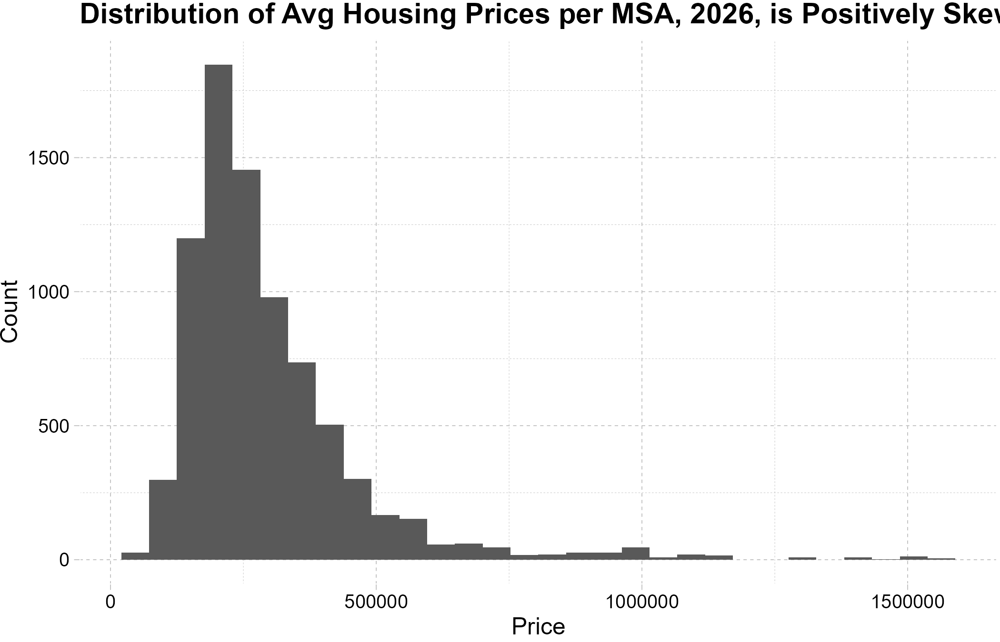
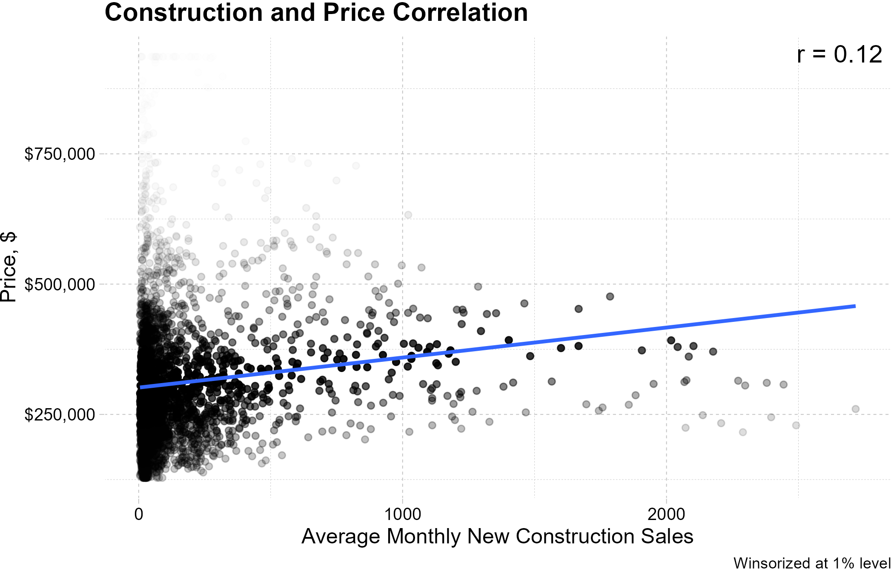

```{r, loading-libraries-and-functions}
#| message: false
#| warning: false
#| include: false

# libraries and functions
library(here)
library(ggplot2) 
library(dplyr) 
library(ggthemes)
library(scales)
library(DescTools)
options(digits = 2)
source(here("pages", "project", "src", "functions", "save_plot_as_png.R"))
```


```{r, getting-data}
#| message: false
#| warning: false
#| include: false

# Call script to read/clean/wrangle and write data for later use 
# if cleaning is not required remove this source() call and ensure
# that you adjust your {here} path to read in the raw data from 
# pages/project/data/ (not the cleaned sub-directory)
#
# If you are using an API call for accessing your data, your 
# data_cleaning.R script would involve accessing the data through
# the api and then saving it locally for reproducibility (see project
# handout). All data are required to be saved as .Rds files for 
# preserve space and to maintain data types (which is not true for 
# .csv files).

source(here("pages", "project", "src", "data", "data_cleaning.R"))

# read data/cleaned data (produced from the above cleaning script)
zillow_cleaned_msa <- readRDS(here("pages", "project", "data", "cleaned", "zillow_cleaned_msa.Rds"))

zillow_cleaned_us <- readRDS(here("pages", "project", "data", "cleaned", "zillow_cleaned_us.Rds"))

```

### Introduction

- Explain about housing prices and their sharp rise have become central to affordability. 
- Want to first look at housing prices at the aggregate, and then break it down by MSA, and compare housing prices to rental prices and construction prices (which areas have the biggest disparity between rentals and home prices? perhaps gives a clue on economic mobility and breaking out of a rental trap)
- Look at how these trends have fluctuated over time

## Data Sources:

All my housing data comes from https://www.zillow.com/research/data/. I get my data for home values from the Zillow Home Value Index prices at the US level, which includes data at both the national level and at MSA granularity. The values are housing prices for all homes, smoothed and seasonally adjusted. 

The construction data looks at ____, while the rental prices look at _____

## Summary Statistics

Data Coverage: I have housing prices since January of 2000, but only have rental prices since January of 2015 and home construction since January of 2018. 

# AGGREGATE ANALYSIS
## One Headline Number As The Title? Housing prices have increased ___ % over the past ___ years in the US

```{r, plot-agg-graph}
#| echo: false
#| message: false
#| warning: false

# create plot for aggregate prices
p_agg <- 
  zillow_cleaned_us |>
  ggplot(mapping = aes(x = date, y = price)) +
  geom_line() + 
  labs(
    title = "Average Housing Prices in the United States Increased Fourfold, 2000-2026",
    x = "Time",
    y = "Price, $USD"
         ) + 
  scale_y_continuous(labels = label_dollar(), limits = c(0, 400000)) + 
  theme_pander()

# consider fixing axes to 1 sd away? 

```

<!-- SAVE PLOT AS PNG -->

```{r, saveplot-agg-graph}
#| message: false
#| warning: false
#| include: false

# save the plot as a .png file using the save_plot_as_png()
save_plot_as_png(
  plot = p_agg,
  file_name = "aggregate_prices.png"
)
```

{width=80% fig-alt="This is alt-text for describing the plot for screen readers ..."}
```{r, headline number}
#| message: false
#| warning: false
#| include: false

change = range(zillow_cleaned_us$price)
p_diff = change[2] / change[1] * 100

```
 

At the aggregate, housing prices have increased from `r scales::dollar(change[1])` to `r scales::dollar(change[2])` from January of 2000 until September of this year, a **`r p_diff`%** difference. This headline number, however, conceals variation in price at more granular geographies, and I am yet to explore how housing prices intertwine with rental prices and construction amount. 

But how do the distributions of home value prices look? I want to use a histogram to look at this, as it can clearly show a distribution of a variable of discrete values. 

```{r, value hist}
#| message: false
#| warning: false
#| include: false

# create plot for distribution of prices across MSAs
p_hist <- 
  zillow_cleaned_msa |>
  filter(year == 2026) |> 
  ggplot(mapping = aes(x = price)) +
  geom_histogram() + 
  labs(
    title = "Distribution of Avg Housing Prices per MSA, 2026, is Positively Skewed",
    x = "Price",
    y = "Count"
         ) + 
  theme_pander()

```

<!-- SAVE PLOT AS PNG -->

```{r, saveplot-hist}
#| message: false
#| warning: false
#| include: false

# save the plot as a .png file using the save_plot_as_png()
save_plot_as_png(
  plot = p_hist,
  file_name = "prices_histogram.png"
)
```

{width=80% fig-alt="This is alt-text for describing the plot for screen readers ..."}
At the MSA level, housing prices are very positively skewed, meaning most MSAs have a lower average housing price; although there are many MSAs with much higher Avg housing price.

### Rental Prices in the US

[PLACEHOLDER]

## Digging Deeper... 

Graph about the correlation between housing construction and home prices (are there clear affects on the supply-side on housing prices? What about rental prices?) Look at the aggregate and then also at the state/MSA
- Use a varying alpha from the correlation line, directly annotate the r on the graph 

```{r, construction-price corr}
#| message: false
#| warning: false
#| include: false

# One row per MSA per year
msa_year <- zillow_cleaned_msa |>
  filter(year >= 2018, !is.na(price), !is.na(construction)) |>
  group_by(RegionID, RegionName, year) |>
  summarise(price        = mean(price),
            construction = mean(construction),
            .groups = "drop") |>
  mutate(price = pmin(pmax(price, quantile(price, 0.01)),
                      quantile(price, 0.99)))

# then fit, compute alpha and plot exactly as before
fit <- lm(price ~ construction, data = msa_year)

# Residuals from the regression line, in SD units, mapped to alpha
fit <- lm(price ~ construction, data = msa_year)

msa_year <- msa_year |>
  mutate(resid_sd = abs(resid(fit)) / sd(resid(fit)),
         alpha    = 0.25^resid_sd)

r <- cor(msa_year$construction, msa_year$price)

p_corr <- msa_year |>
  ggplot(aes(x = construction, y = price)) +
  geom_point(aes(alpha = alpha)) +
  geom_smooth(method = "lm", se = FALSE) +
  scale_alpha_identity() +
  scale_y_continuous(labels = label_dollar()) +
  labs(
    title = "Construction and Price Correlation",
    x = "Average Monthly New Construction Sales",
    y = "Price, $",
    caption = "Winsorized at 1% level"
  ) +
  theme_pander()

p_corr <- p_corr +
  annotate("text",
           x = Inf, y = Inf,
           label = paste0("r = ", round(r, 2)),
           hjust = 1.1, vjust = 1.5,
           size = 5)

```

```{r, saveplot-corr}
#| message: false
#| warning: false
#| include: false

# save the plot as a .png file using the save_plot_as_png()
save_plot_as_png(
  plot = p_corr,
  file_name = "const_prices_corr.png"
)
```


{width=80% fig-alt="This is alt-text for describing the plot for screen readers ..."}

Note: I changed the alphas of the points to fade when further from the correlation, according to the findings of Strain et al. 

The correlation between housing prices and construction is 0.12, which is counter to what I would expect if supply-and-demand were to hold true (more construction leads to more supply which decreases price).
There are some issues with this plot, namely that sampling is not independent (multiple MSAs show up in different years). Also, construction likely has some sort of lagged effect, perhaps into the next month or the next year. I want to create a plot or edit the data to reflect this lag (and also make independence valid) by looking at the change in housing prices (perhaps relative to the national trend?) following construction. I have to think about it more. Also how I can control for larger metros.

# Buy-Rent Disparity Index

Rental prices are obviously closely related to housing prices. However, it is perhaps the case that...
Housing price / rental price disparity index:
- Construct for each MSA a ratio of avg home price to rental price
- Make a distribution graph of that (raincloud plot?)
- Merge in population/income information, see if there is any relationship between this index and income per capita? 


