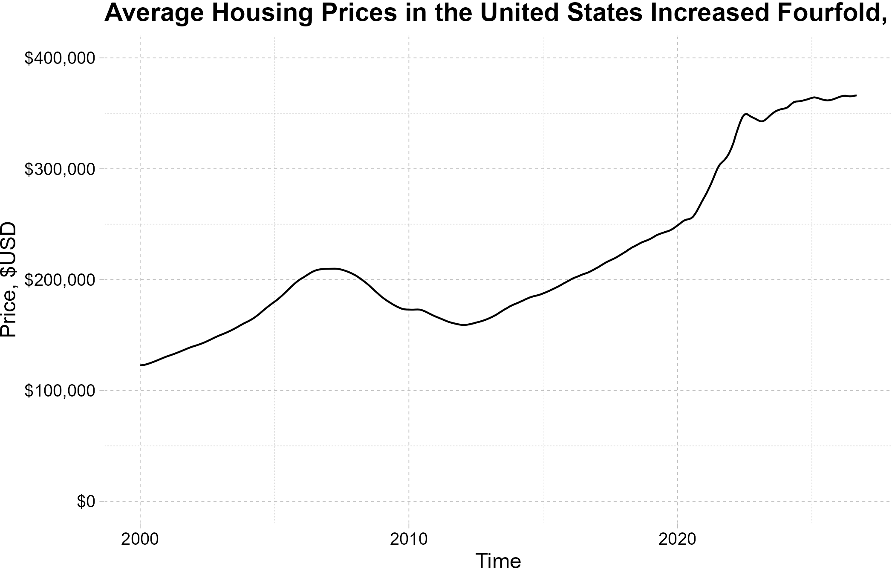

```{r, loading-libraries-and-functions}
#| message: false
#| warning: false
#| include: false

# libraries and functions
library(here)
library(ggplot2) 
library(dplyr) 
library(ggthemes)
library(scales)
options(digits = 2)
source(here("pages", "project", "src", "functions", "save_plot_as_png.R"))
```


```{r, getting-data}
#| message: false
#| warning: false
#| include: false

# Call script to read/clean/wrangle and write data for later use 
# if cleaning is not required remove this source() call and ensure
# that you adjust your {here} path to read in the raw data from 
# pages/project/data/ (not the cleaned sub-directory)
#
# If you are using an API call for accessing your data, your 
# data_cleaning.R script would involve accessing the data through
# the api and then saving it locally for reproducibility (see project
# handout). All data are required to be saved as .Rds files for 
# preserve space and to maintain data types (which is not true for 
# .csv files).

source(here("pages", "project", "src", "data", "data_cleaning.R"))

# read data/cleaned data (produced from the above cleaning script)
zillow_cleaned_msa <- readRDS(here("pages", "project", "data", "cleaned", "zillow_cleaned_msa.Rds"))

zillow_cleaned_us <- readRDS(here("pages", "project", "data", "cleaned", "zillow_cleaned_us.Rds"))

```

### Introduction

- Explain about housing prices and their sharp rise have become central to affordability. 
- Want to first look at housing prices at the aggregate, and then break it down by MSA, and compare housing prices to rental prices and construction prices (which areas have the biggest disparity between rentals and home prices? perhaps gives a clue on economic mobility and breaking out of a rental trap)
- Look at how these trends have fluctuated over time

## Data Sources:

All my housing data comes from https://www.zillow.com/research/data/. I get my data for home values from the Zillow Home Value Index prices at the US level, which includes data at both the national level and at MSA granularity. The values are housing prices for all homes, smoothed and seasonally adjusted. 

The construction data looks at ____, while the rental prices look at _____

## Summary Statistics

(Missingness, year coverage, etc.)

# AGGREGATE ANALYSIS
## One Headline Number? Housing prices have increased ___ % over the past ___ years in the US

```{r, plot-mpg-by-wt-for-cyl}
#| echo: false
#| message: false
#| warning: false

# create plot for aggregate prices
p_agg <- 
  zillow_cleaned_us |>
  ggplot(mapping = aes(x = date, y = price)) +
  geom_line() + 
  labs(
    title = "Average Housing Prices in the United States",
    x = "Time",
    y = "Price"
         ) + 
  scale_y_continuous(labels = label_dollar(), limits = c(0, 400000)) + 
  theme_pander()

# consider fixing axes to 1 sd away? 

```

<!-- SAVE PLOT AS PNG -->

```{r, saveplot-cyl-subset}
#| message: false
#| warning: false
#| include: false

# save the plot as a .png file using the save_plot_as_png()
save_plot_as_png(
  plot = p_agg,
  file_name = "aggregate_prices.png"
)
```

{width=80% fig-alt="This is alt-text for describing the plot for screen readers ..."}
```{r, headline number}
#| message: false
#| warning: false
#| include: false

change = range(zillow_cleaned_us$price)
p_diff = change[2] / change[1] * 100

```
 
At the aggregate, housing prices have increased from `r scales::dollar(change[1])` to `r scales::dollar(change[2])` from January of 2000 until September of this year, a **`r p_diff`%** difference. 

## Digging Deeper... 

